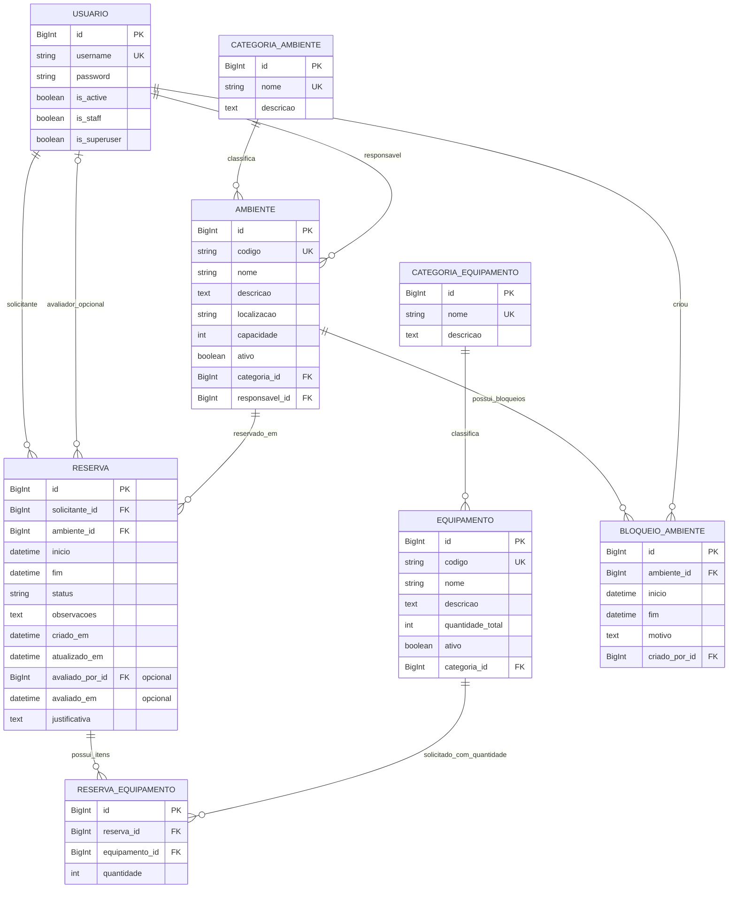

# Diagrama entidade-relacionamento

O diagrama representa as oito entidades de domínio implementadas no Checkpoint 1. Grupos/permissões e tabelas internas do Django foram omitidos para manter o foco no domínio. FKs opcionais e obrigatórias seguem os modelos e migrations atuais.

`Reserva` e `Equipamento` formam uma relação N:N por `ReservaEquipamento`; cada linha intermediária guarda a quantidade solicitada. A relação com `avaliado_por` é opcional do lado de `Reserva`. As demais FKs exibidas são obrigatórias.

As regras de unicidade e intervalo não são cardinalidades: `ReservaEquipamento` também possui unicidade para `(reserva_id, equipamento_id)` e quantidade mínima 1. Os detalhes de constraints e políticas `on_delete` estão em [modelagem.md](modelagem.md).
